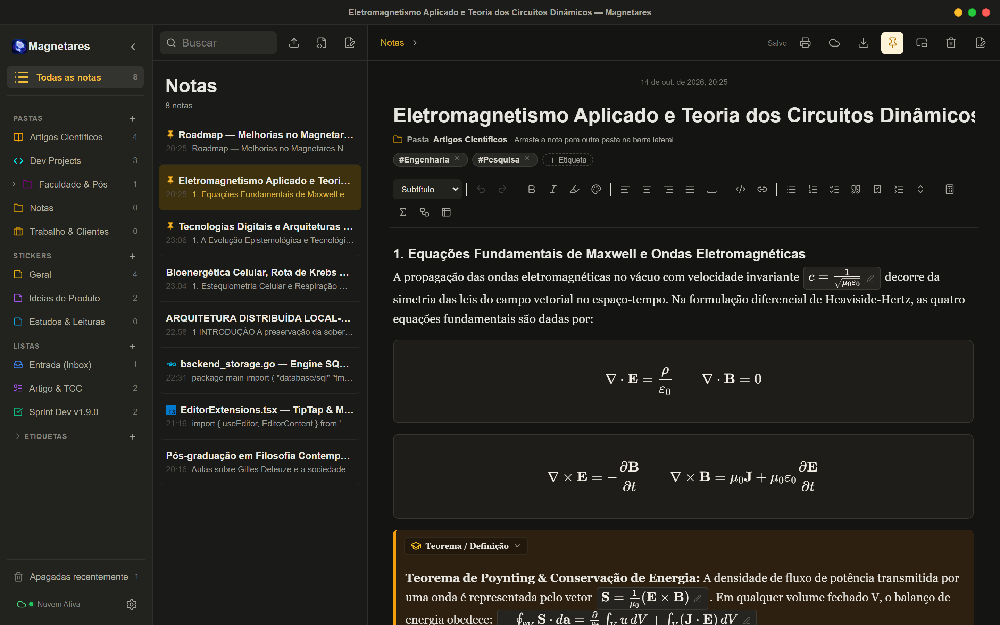
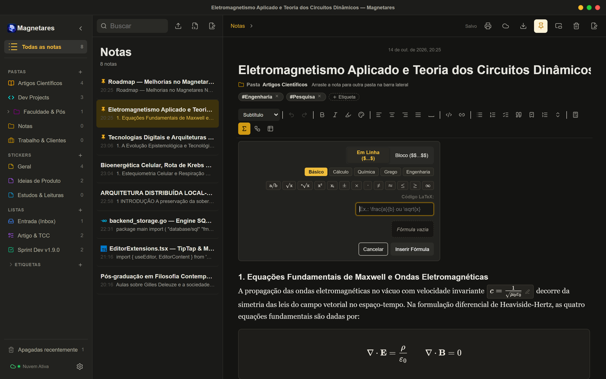
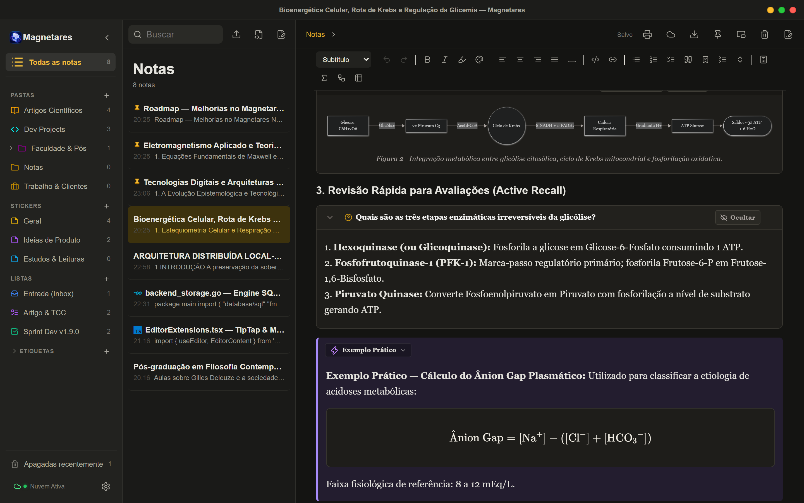
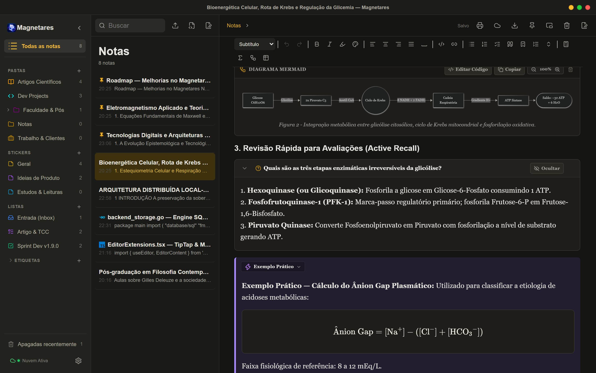
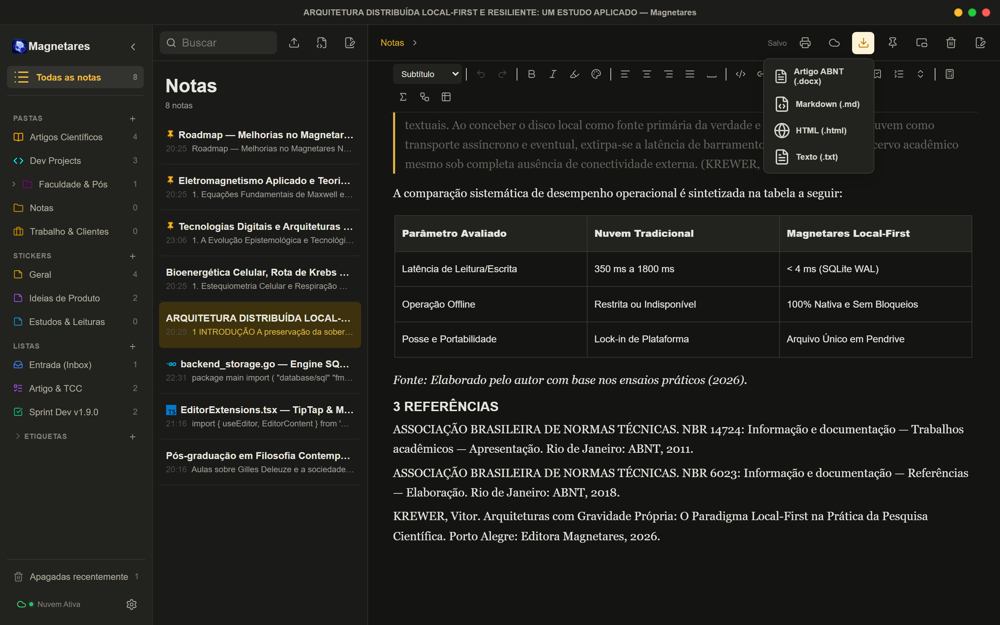

# Fórmulas KaTeX, Diagramas Mermaid, Active Recall e Exportação ABNT

Quem estuda ou pesquisa nas áreas de **Engenharia, Física, Matemática, Química, Farmácia, Medicina ou Biologia** conhece bem a frustração de tentar fazer anotações científicas em aplicativos de notas convencionais.

Em um momento, você está no meio de uma aula ou laboratório tentando registrar uma integral de linha, uma reação de estequiometria ou um fluxograma de malha fechada. No outro, percebe que o editor trata a matemática como texto puro achatado, quebra as fórmulas se não houver internet para carregar bibliotecas externas, ou simplesmente não oferece nenhuma ferramenta para representar processos e diagramas técnicos. E, quando o trabalho fica pronto, começa o segundo martírio: copiar e colar tudo para um processador de texto comercial e passar horas ajustando margens, recuos e referências bibliográficas segundo as normas da ABNT.

A futura **versão 1.9.0** do Magnetares Notes nasce para extinguir essa distância. Hoje entregamos um ecossistema completo que acompanha o estudante e o pesquisador desde o primeiro rascunho de dedução na bancada até o artigo formatado para entrega.

---

## 1. Fórmulas Matemáticas e Químicas 100% Offline (KaTeX + mhchem)

Fórmulas científicas não são ilustrações estáticas; são a linguagem fundamental do raciocínio em ciências exatas e biomédicas. Implementamos suporte nativo completo ao motor **KaTeX** com empacotamento vetorial direto no binário do Magnetares.

Isso significa **zero chamadas a servidores externos, zero latência e funcionamento absoluto sem internet**, no laboratório ou no campo.

### Suporte Duplo: Inline e Bloco
- **Fórmulas em linha (`$formula$`):** Fluem naturalmente no parágrafo para expressar grandezas e relações rápidas, como o limite $c = \frac{1}{\sqrt{\mu_0 \varepsilon_0}}$ ou grandezas vetoriais.
- **Fórmulas em bloco (`$$formula$$`):** Centralizadas e destacadas, ideais para deduções teóricas extensas, matrizes $3 \times 3$, transformadas de Fourier e equações diferenciais.

### Teclado Visual de Símbolos para Engenharia e Exatas
Sabemos que ninguém quer decorar de cabeça dezenas de comandos de barra invertida durante uma aula dinâmica. Desenvolvemos um editor interativo com Live Preview e um painel de inserção rápida categorizado em 4 conjuntos práticos:
- **Básico:** Frações $\frac{a}{b}$, raízes $\sqrt{x}$, expoentes $x^2$, subscritos $x_i$, $\pm$, $\times$, $\approx$, $\le$, $\ge$, $\infty$.
- **Cálculo & Física:** Integrais definidas $\int_a^b$, integrais duplas $\iint$, somatórios $\sum$, produtórios $\prod$, derivadas parciais $\frac{\partial f}{\partial x}$, limites $\lim$, vetores $\vec{v}$ e gradiente $\nabla$.
- **Alfabeto Grego:** Coleção completa de variáveis físicas e matemáticas ($\alpha, \beta, \gamma, \Delta, \theta, \lambda, \mu, \pi, \rho, \sigma, \tau, \omega, \Omega$).
- **Modelos Rápidos:** Modelos prontos em um clique para fórmula de Bhaskara, Lei de Ohm, Potência Elétrica, Matrizes e Leis de Gauss.

### Química e Bioquímica com Notação `mhchem`
Para estudantes de Farmácia, Química, Biomedicina e Medicina, o KaTeX inclui nativamente o pacote `mhchem` através da diretiva `\ce{...}`. O sistema formata automaticamente estados de oxidação, cargas iônicas, coeficientes estequiométricos, equilíbrios ($\rightleftharpoons$) e reações redox sem necessidade de malabarismos com índices:
$$\ce{C6H12O6 + 6O2 -> 6CO2 + 6H2O + 32 ATP}$$
$$\ce{H+ + HCO3- <=> H2CO3 <=> CO2 + H2O}$$

---

## 2. Diagramas Técnicos e Biológicos com Mermaid.js

Muitas ideias científicas só ganham clareza quando visualizadas espacialmente: arquiteturas de controle, rotas metabólicas celulares, arcos reflexos de feedback fisiológico ou máquinas de estado em eletrônica.

Integramos o motor **Mermaid.js** totalmente embutido no cliente, gerando diagramas vetoriais em SVG limpos e proporcionais:

- **Controle & Engenharia:** Fluxogramas de tomada de decisão com nós condicionais, sensores e atuadores.
- **Biologia & Fisiologia:** Ciclos metabólicos (Ciclo de Krebs, Glicólise, Fosforilação Oxidativa) e sistemas de regulação homeostática (controle de glicemia por insulina e glucagon).
- **Computação & Dados:** Diagramas de sequência com numeração automática, máquinas de estado e diagramas entidade-relacionamento (ER).
- **Zoom Dinâmico e Legenda:** Controles integrados de ampliação (+/-), restauração de zoom e identificação de legenda para figuras científicas.

---

## 3. Destaques Acadêmicos (*Callouts*) e Estudo Ativo (*Active Recall*)

A retenção de conteúdo em cursos de alta densidade teórica exige organização visual semântica e auto-teste contínuo.

### Caixas Semânticas (Callouts)
Criamos um bloco estruturado com 5 categorias temáticas projetadas para cadernos acadêmicos:
1. 💡 **Nota / Informação:** Contexto histórico e apontamentos gerais.
2. 📐 **Teorema / Definição:** Leis da física, definições matemáticas formais e corolários.
3. 🔬 **Experimento / Laboratório:** Protocolos de ensaio, parâmetros de bancada e dados empíricos.
4. ⚠️ **Atenção / Alerta Clínico:** Contraindicações farmacológicas, cuidados em bancada e diagnósticos diferenciais.
5. ⚡ **Exemplo Prático:** Exercícios resolvidos e dimensionamento de componentes.

O tipo de destaque pode ser alternado a qualquer instante com um clique no cabeçalho do bloco, e a sintaxe é exportada com total compatibilidade para GitHub e Obsidian (`> [!NOTE]`, `> [!THEOREM]`).

### Blocos Expansíveis (*Toggles* para Active Recall)
Para provas, simulados e fixação de fórmulas, nada supera a prática de **recuperação ativa** (*active recall*). Os novos blocos sanfonados permitem que o estudante coloque a pergunta ou problema no título e oculte a dedução, resolução ou resposta dentro do corpo expansível.
- Suporte a fórmulas KaTeX diretamente no título da pergunta.
- Botão rápido para revelar/ocultar a resposta.
- Atalho global de auto-teste na barra de ferramentas para recolher ou expandir todas as perguntas da nota de uma vez só.

---

## 4. O Elo Perdido: Exportação de Artigos no Padrão ABNT (.docx)

Depois de anotar deduções, colar tabelas de ensaios e organizar referências, o passo final do ciclo acadêmico é a entrega formal.

Em vez de obrigar o aluno a gastar horas formatando manualmente margens e fontes em softwares de escritório, o Magnetares agora conta com o motor **Exportar Artigo ABNT (.docx)**, acessível discretamente dentro do menu de exportação da barra superior:

O documento gerado segue rigorosamente as diretrizes das normas brasileiras:
- **Margens Oficiais (NBR 14724):** Superior 3 cm, Esquerda 3 cm, Inferior 2 cm e Direita 2 cm.
- **Tipografia e Espaçamento:** Fonte Arial 12 pt no corpo do texto, entrelinhas de 1,5 linha e recuo de primeira linha de 1,25 cm em todos os parágrafos.
- **Numeração de Páginas:** Paginação consecutiva no cabeçalho superior direito a 2 cm da borda.
- **Títulos e Seções Numeradas (NBR 6024):** Título principal centralizado em 14 pt negrito maiúsculo; seções e subtítulos (`1 INTRODUÇÃO`, `2 FUNDAMENTAÇÃO`) numerados com hierarquia tipográfica correta.
- **Citações Longas Diretas (NBR 10520):** Citações textuais com mais de 3 linhas formatadas em bloco destacado com recuo de 4 cm à esquerda, fonte Arial 10 pt, espaçamento simples e sem aspas.
- **Tabelas Acadêmicas (Padrão IBGE / ABNT):** Bordas horizontais nítidas no topo e na base, sem fechamento de bordas verticais externas, texto centralizado em 10 pt, numeração consecutiva com título acima ("Tabela 1") e fonte obrigatória abaixo ("Fonte: Elaborado pelo autor").
- **Seção de Referências (NBR 6023):** Alinhamento justificado estritamente à esquerda, entrelinhas simples e separação de 1 linha em branco entre cada referência bibliográfica.

Tudo é processado **100% em memória local** e gravado pelo diálogo nativo do sistema operacional, sem envio de nenhum fragmento da sua pesquisa para servidores na nuvem.

---

## 5. Impressão e PDF com Diagramação Inteligente

Aprimoramos também o motor de impressão direta (`Ctrl+P`). O novo algoritmo de diagramação `@media print`:
- Impede que fórmulas KaTeX, diagramas Mermaid, callouts e tabelas sejam fatiados no meio de quebras de página (`break-inside: avoid`).
- Repete automaticamente o cabeçalho (`thead`) de tabelas longas no topo de cada nova página.
- Abre automaticamente todos os blocos de estudo ativo para compor apostilas completas de revisão.
- Normaliza contrastes e fundos escuros para preto puro (#111) no papel, economizando tinta e garantindo legibilidade perfeita.

---

## Onde Ideias e Ciência Ganham Órbita

Com este ciclo, o Magnetares Notes reafirma sua identidade como uma estação de trabalho pensada com seriedade técnica para quem precisa de velocidade, rigor e privacidade.

As notas continuam sendo suas, gravadas no seu disco em SQLite, portáteis no seu pendrive com a futura ersão Multiverse, e agora prontas para atender aos mais exigentes padrões da ciência e da academia.
