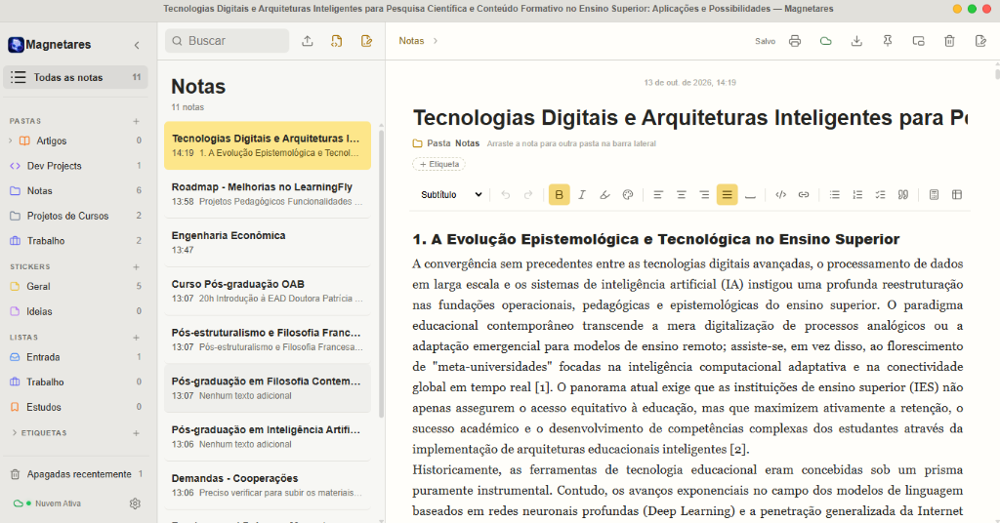
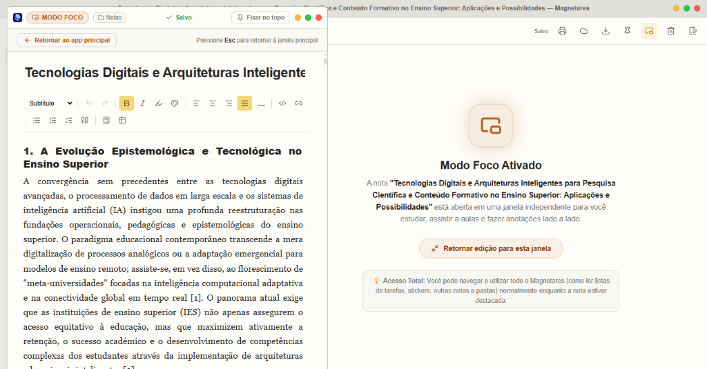

# Portabilidade total e Markdown com vida

Quem já foi acadêmico ou está em período letivo sabe o sufoco de ter que de migrar entre diversos computadores. O computador do laboratório da faculdade liga com aquele barulho característico de ventoinha cansada. Na tela, um sistema operacional diferente do meu notebook pessoal ou da empresa, uma área de trabalho limpa e nenhuma permissão de administrador para instalar qualquer programa.

Tiro o pendrive do bolso da mochila. Nele estão resumos, listas de matérias, tabelas de estudo e arquivos de texto acumulados ao longo dos semestres.

Conecto a unidade USB, abro a pasta de anotações e me deparo com dois incômodos que vinham me perseguindo há dias.

---

## O incômodo de perder a estrutura das ideias

O primeiro incômodo acontecia toda vez que eu tentava resgatar uma anotação antiga. Ao importar um arquivo `.md` ou `.txt` criado em outro editor — cheio de títulos organizados, tabelas de fórmulas e caixas de seleção `- [ ]` com tarefas do semestre —, o aplicativo simplesmente achatava tudo. O texto caía na tela como um bloco corrido de texto puro. O conteúdo estava ali, mas a vida do documento havia desaparecido. Para marcar uma tarefa como feita ou navegar pelos tópicos, eu precisava reformatar quase tudo na mão.

Nas primeiras versões do Magnetares, a importação de arquivos .md era muito limitada. Eu importava um arquivo .md e ele era simplesmente convertido em um arquivo de texto puro. Aí vinha o trabalho repetitivo, reformatar os títulos, as listas, as tabelas... Um processo que consumia tempo precioso que poderia ser usado para estudar. Tudo isso tornava difícil organizar minhas anotações e acompanhar meu progresso.

O segundo incômodo era a sensação de ficar preso a um único computador. Quem estuda ou trabalha circulando entre máquinas — o notebook de casa, o PC com Linux da faculdade ou o computador do trabalho — conhece o receio de ter que fazer login em navegadores de terceiros ou deixar rastros locais de navegação e arquivos temporários.

Eu não queria ter que "instalar" o Magnetares em cada máquina que cruzasse meu caminho, inserir os dados da nuvem novamente para cada máquina. Principalmente por questões de segurança. Eu só queria plugar o pendrive, abrir minhas anotações, estudar e desplugar com a certeza de que tudo continuava seguro no meu bolso.

E havia ainda um detalhe visual que incomodava no uso diário: à medida que as matérias acumulavam pastas, tarefas e etiquetas, a lixeira de notas sumia no final da barra lateral toda vez que eu expandia as tags, forçando uma rolagem desnecessária.

Foi desse conjunto de pequenas fricções que nasceu a pergunta:  
*E se um único pendrive pudesse rodar em qualquer sistema operacional compartilhando exatamente o mesmo caderno, e se qualquer arquivo Markdown pudesse entrar no aplicativo mantendo intacta toda a sua riqueza de títulos, tabelas e tarefas?*

---

## A solução: notas que viajam e Markdown com vida

Dediquei o desenvolvimento de hoje para resolver essas pontas soltas na construção da futura **versão 1.9.0**:

### 1. Importação com compilação real de Markdown
Em vez de apenas colar o conteúdo de arquivos `.md`, `.markdown` e `.txt` como parágrafos simples, implementei uma compilação direta para os nós ricos do editor:
- **Títulos e subtítulos:** Cabeçalhos `#` e `##` viram nós de título nativos, e o título principal é identificado de forma inteligente sem se duplicar no início do texto.
- **Checklists funcionais:** Linhas com `- [ ]` e `- [x]` são convertidas diretamente em listas de tarefas interativas, permitindo marcar pendências e reativando os contadores de tarefas abertas do SQLite.
- **Tabelas e códigos:** Tabelas ganham linhas e colunas estruturadas, e blocos de código preservam sua formatação e identificação de linguagem.
- **Formatações inline:** Negritos, itálicos, tachados e até textos destacados com `==marcação==` entram prontos para leitura.

### 2. Testando na prática o Modo Foco (Picture-in-Picture)
No texto anterior, compartilhei a necessidade de não negociar espaço na tela durante as aulas e a concepção da nossa janela independente de foco. Hoje, enquanto organizava e importava artigos acadêmicos densos, aproveitei para colocar o novo Modo Foco à prova na minha rotina real de estudos.

A sensação de destacar um artigo científico em uma janela flutuante compacta — com fixação no topo e sincronização bidirecional em tempo real pelo SQLite — enquanto a janela principal continua 100% aberta e navegável para consultar listas de matérias, navegar por outras pastas ou revisar tarefas, mudou completamente a experiência. No aplicativo principal, um card translúcido e discreto indica o estado ativo da nota e permite retornar a qualquer momento com um único clique (ou pelo atalho `Esc`). Ver aquilo que no dia anterior era apenas uma ideia agora rodando com tanta estabilidade no fluxo real de anotações dá a certeza de que a v1.9.0 está ganhando corpo da melhor forma possível.

### 3. A Versão Portable Multiverse
O banco de dados SQLite local sempre foi universal por natureza, mas faltava transformar essa vantagem em liberdade prática. Desenvolvi o conceito da versão "Multiverse":
- Um único pacote portátil para pendrive que reúne os executáveis de **Windows (`.exe`)**, **Linux (`.AppImage`)** e **macOS (`.app`)**, todos apontando para a mesmíssima pasta `./data/magnetares.db` na raiz do dispositivo USB.
- O sistema detecta onde está rodando de forma invisível. No Windows, por exemplo, o cache do navegador interno é isolado dentro do pendrive, garantindo zero rastros no computador hospedeiro.
- Você estuda no Windows em casa, leva o pendrive para o laboratório com Linux ou para o notebook de um colega com Mac, clica duas vezes e encontra suas notas no exato estado em que as deixou.

### 4. Lixeira sempre ao alcance
Retirei o botão de "Apagadas recentemente" de dentro da rolagem de pastas e etiquetas. Agora ele mora fixo na base da barra lateral, ancorado logo acima do status da nuvem e das configurações. Você pode ter dezenas de pastas e etiquetas abertas: a lixeira nunca sai do lugar.

### 5. Cuidado com a identidade e a base de código
Aproveitei também para varrer e padronizar os módulos internos do projeto, aposentando definitivamente os últimos nomes remanescentes dos primeiros protótipos e alinhando os módulos Go diretamente à estrutura canônica do repositório no GitHub.

---

## O valor de ferramentas que se adaptam à vida

Ferramentas de anotações não deveriam exigir que a gente mude nossa rotina para usá-las. Elas deveriam ser discretas o suficiente para caber em qualquer momento — seja numa mesa silenciosa em casa, seja numa máquina comunitária dez minutos antes da aula começar.

Todas essas melhorias já foram integradas e farão parte do lançamento da **versão 1.9.0**, que segue sendo preparada com muito empenho e testes de estabilidade.

Se você também carrega suas ideias de um lado para o outro, espero que essas novidades tornem suas anotações realmente privadas e portáveis.

Até o próximo registro...

---

*Acompanhe o desenvolvimento pelo [GitHub](https://github.com/vitorkrewer/magnetares-notes).*
