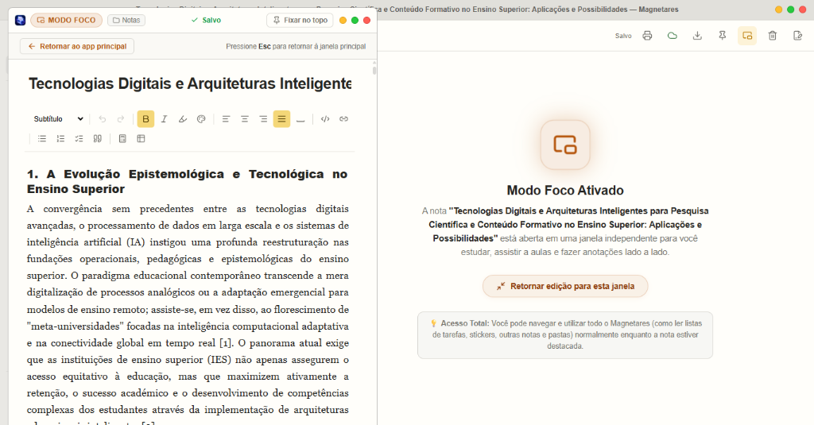
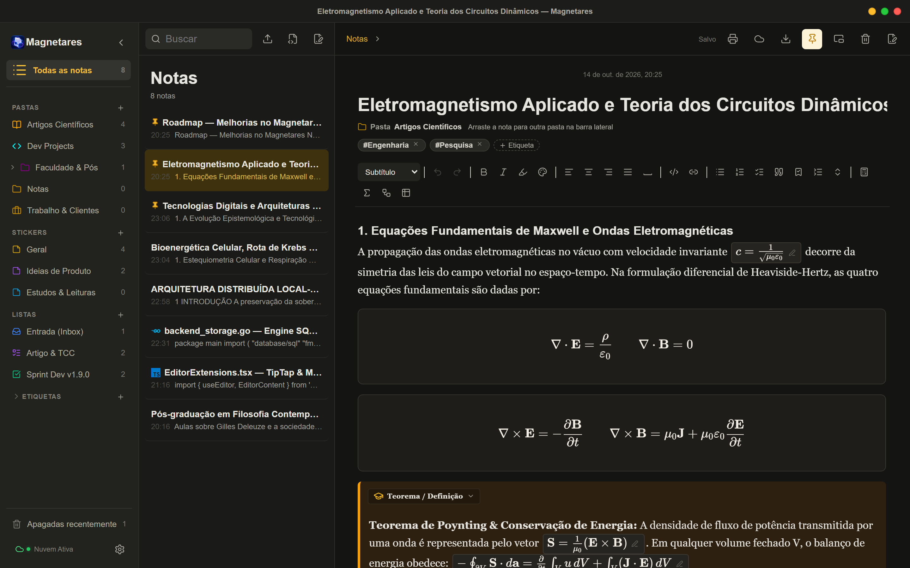
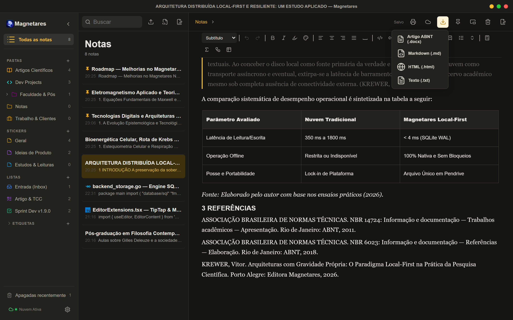

# Magnetares Notes v1.9.0: Lançamento Oficial, Exportação Nativa em PDF e o Maior Salto da Nossa Jornada

Chegou o momento que venho construindo e ajustando nas últimas semanas: **a versão 1.9.0 do Magnetares Notes está oficialmente lançada!**

Olhar para trás e ver o tamanho que esta atualização tomou dá uma sensação missão cumprida, de dever cumprido. Desenvolvo o Magnetares Notes para meu próprio estudo e uso, contando com o auxílio da inteligência artificial como parceira de programação para transformar cada ideia, dor real de estudo e detalhe de engenharia em código sólido. Construir um software dessa complexidade de forma independente tem seus desafios diários, mas traz um privilégio único: cada recurso nasce do uso real, sem burocracia, testado na prática entre aulas da faculdade, anotações técnicas, simulados e madrugadas de código. É também uma forma de tornar palpável os conceitos e práticas aprendidos durantes os cursos de Engenharia de Software, UX Design e Go.

E, justamente por usar o aplicativo todos os dias, antes de bater o martelo e publicar os instaladores oficiais da **v1.9.0**, dediquei os últimos dias para resolver um último ponto de atenção que me incomodou ao imprimir minhas notas de controle e roadmap, além de incluir um recurso que faltava no menu de exportação: a **exportação nativa direta em PDF (`.pdf`)**.

Abaixo, compartilho os ajustes finais e as entregas de hoje e tudo o que passa a fazer parte oficialmente da **versão 1.9.0**.

---

## Os Ajustes Finais de Hoje: Impressão Limpa e Exportação Nativa em PDF (`.pdf`)

Ao clicar no botão de **Imprimir** para gerar uma versão em folha da minha nota *"Roadmap and Debugs"*, reparei em dois detalhes visuais que quebravam a sobriedade do documento:
1. O fundo creme acolhedor do tema claro (`#f6f6f2`) acabava escapando para a área externa do WebView2, criando uma **borda colorida** ao redor da página branca na visualização de impressão.
2. Na base e no topo da folha, logo abaixo do rodapé oficial do aplicativo, o navegador interno do sistema insistia em estampar marcações técnicas como `wails.localhost:34115`, a data bruta do navegador e a paginação `1/4`.

Eu não podia lançar a versão 1.9.0 deixando essa impressão passar. Mergulhei no código com o auxílio da IA para atacar a causa na raiz e aproveitar o embalo para ir um passo além.

### 1. Fim da Borda Colorida e do `wails.localhost` na Impressão
Para deixar a folha impressa impecável:
- **Fundo Branco Puro na Janela Nativa e no `@media print`:** Ajustei a cor base do componente WebView2 no núcleo em Go (`main.go`) e forcei todas as variáveis de superfície (`--bg`, `--paper`, `#root`, `html`, `body`) para branco absoluto (`#ffffff`) durante a impressão. Aquela moldura creme ao redor da folha desapareceu por completo.
- **Supressão dos Cabeçalhos e Rodapés do WebView (`@page { margin: 0mm }`):** Configurei a diretiva `@page` em A4 retrato com margem física zero no motor de impressão do Chromium/WebView2. Isso desativa automaticamente a injeção do endereço `wails.localhost:34115` e dos cabeçalhos do navegador, enquanto o espaçamento interno da folha A4 passa a ser controlado com precisão milimétrica pelo próprio editor (`padding: 15mm 16mm 20mm 16mm` com `box-decoration-break: clone`), preservando apenas o nosso rodapé institucional **"Gerado via Magnetares Notes"**.

### 2. Nova Opção no Menu: Exportar Documento PDF (`.pdf`) Nativamente
Até ontem, o menu **Exportar** da barra superior contava com *Artigo ABNT (.docx)*, *Markdown (.md)*, *HTML (.html)* e *Texto (.txt)*. Para gerar um PDF, era sempre necessário passar pela janela de impressão do sistema.

Adicionei a opção **Documento PDF (.pdf)** diretamente no menu de exportação:
- **Gerador PDF 1.4 Vetorial e 100% Offline:** Implementei um motor próprio (`pdfExport.ts`) que constrói o binário do arquivo PDF diretamente em memória e abre a janela nativa **"Salvar como..."** do sistema operacional.
- **Fidelidade de Ponta a Ponta:** O PDF gerado mantém textos vetoriais selecionáveis com acentuação completa em português, títulos hierárquicos, negrito, itálico, sublinhado, **checklists com caixas de seleção âmbar (`✓`) e texto riscado nas tarefas concluídas**, tabelas com cabeçalho que se repete automaticamente em novas páginas, caixas de destaque (*Callouts*), blocos *Toggle*, fórmulas matemáticas, diagramas Mermaid e blocos de código, além do rodapé *"Gerado via Magnetares Notes"* numerado em todas as páginas.

---

## O Lançamento Oficial da Versão 1.9.0: O Que Chega Hoje

Com esses ajustes concluídos, a **v1.9.0** chega oficialmente como a maior atualização desde que escrevi a primeira linha do Magnetares Notes. Nos últimos posts do blog fui compartilhando os bastidores de cada etapa, e hoje todas elas se unem em uma versão estável, rápida e pronta para produção:

### 1. Modo Foco em Janela Independente (Picture-in-Picture)
Nascido da minha própria necessidade de assistir a aulas e ler materiais técnicos sem precisar disputar espaço de tela com barras laterais:
- Destaque qualquer nota em uma **janela nativa separada e enxuta** do sistema operacional.
- Use o botão **Fixar no Topo (*Always-on-Top*)** para manter a anotação flutuando ao lado do vídeo ou PDF, enquanto a janela principal do Magnetares continua 100% livre para você consultar outras pastas ou listas de tarefas.
- Tudo sincroniza em tempo real entre as janelas via `BroadcastChannel` e SQLite WAL.

### 2. Suíte Científica e Acadêmica 100% Offline
Para quem estuda ou trabalha com **Engenharia, Exatas, Química, Farmácia, Medicina, Biologia ou Computação**, o editor agora fala a língua da ciência sem depender de internet:
- **Fórmulas Matemáticas com `KaTeX` + Teclado Visual de Símbolos:** Equações em linha (`$...$`) e blocos matemáticos (`$$...$$`) com painel visual de inserção rápida para cálculo, física, matrizes e alfabeto grego.
- **Química e Bioquímica com `mhchem` (`\ce{...}`):** Reações químicas, estequiometria, íons e equilíbrios formatados automaticamente.
- **Diagramas Técnicos e Biológicos com `Mermaid.js`:** Fluxogramas de controle, ciclos metabólicos, máquinas de estado, mapas mentais e diagramas ER renderizados em SVG diretamente na nota, com zoom integrado.
- **Destaques Acadêmicos (*Callouts*) e Estudo Ativo (*Active Recall*):** Caixas semânticas para *Teoremas*, *Experimentos*, *Alertas Clínicos* e *Exemplos Práticos*, além de blocos sanfonados (*Toggles*) para ocultar respostas e estudar no **Modo Simulado**.

### 3. Exportação de Artigos no Padrão ABNT (`.docx`)
Do rascunho de estudo direto para a entrega formal na faculdade: o exportador **Artigo ABNT (.docx)** gera documentos do Word com margens oficiais (NBR 14724: 3 cm superior/esquerda e 2 cm inferior/direita), fonte Arial 12 pt, espaçamento 1,5, recuo de parágrafo de 1,25 cm, citações longas recuadas a 4 cm (NBR 10520), tabelas no padrão IBGE e seção de Referências (NBR 6023).

### 4. Edição Portable Multiverse, Compilador Markdown e Tabelas Inteligentes
- **Portable Multiverse:** Um único pacote ZIP para pendrives contendo os executáveis de **Windows (`.exe`)**, **Linux (`.AppImage`)** e **macOS (`.app`)** compartilhando o mesmo banco `./data/magnetares.db`, sem deixar rastros nas máquinas da faculdade ou do trabalho.
- **Importação e Compilação Rica de Markdown:** Arquivos `.md`, `.markdown` e `.txt` importados ou colados agora são convertidos diretamente em títulos, checklists interativos, tabelas e blocos de código reais do editor.
- **Colar Inteligente de Planilhas/CSV e Lixeira Fixa:** Cole dados do Excel, Google Sheets ou `.csv` direto como tabelas formatadas e acesse a Lixeira a qualquer momento no rodapé fixo da barra lateral.

---

## Obrigado por Acompanhar Essa Construção

Lançar a **versão 1.9.0** trabalhando de forma independente, unindo minha visão de produto ao poder da IA no desenvolvimento, mostra o quanto é possível construir ferramentas locais, privadas, rápidas e profundamente úteis quando colocamos cuidado em cada detalhe.

Os novos instaladores para **Windows, Linux e macOS**, assim como o pacote **Portable Multiverse**, já estão disponíveis na [Página de Releases](release.html) e na seção de downloads da [Página Inicial](index.html#downloads).

Espero de verdade que esta versão faça diferença nos seus estudos, pesquisas e projetos diários.

Até a próxima...

---

*Acompanhe o desenvolvimento pelo [GitHub](https://magnetaresnotes.com.br).*
