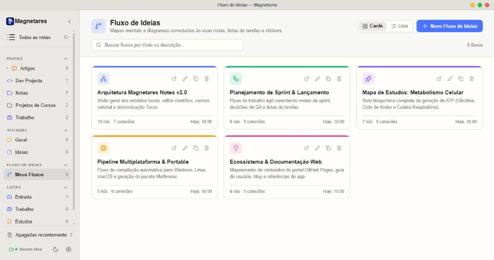
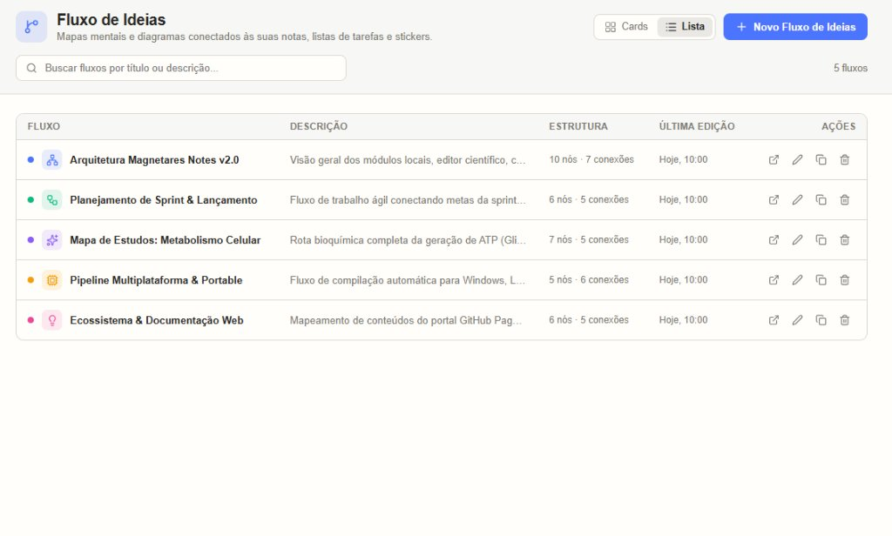
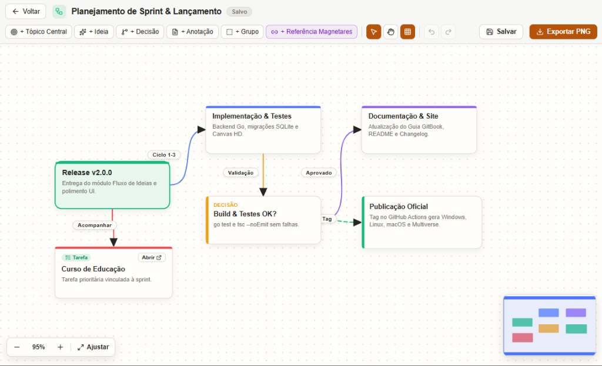

# Magnetares Notes v2.0.0: O Novo Fluxo de Ideias

Quando comecei a construir o Magnetares Notes, meu objetivo sempre foi ter um espaço que promovesse foco, fosse rápido e privado para registrar o que importa. Com o passar do tempo, percebi que nem todo pensamento nasce pronto para virar um texto corrido ou uma lista de tarefas. Muitas vezes, antes de escrever um artigo, planejar um projeto ou estudar uma matéria complexa, preciso enxergar o todo: colocar as ideias lado a lado, traçar caminhos e entender como uma coisa se conecta com outra.

É exatamente dessa necessidade que nasce a **versão 2.0.0**, trazendo o novo módulo **Fluxo de Ideias**.

---

## Um Espaço Visual para Organizar Pensamentos

Logo abaixo dos Stickers na barra lateral, incluí a seção **Fluxo de Ideias** com acesso direto em **Meus Fluxos**. A proposta é oferecer um painel simples para gerenciar seus mapas mentais e diagramas sem sair do aplicativo.

Você pode escolher entre visualizar seus projetos em formato de **Cards** — ideal para bater o olho nas cores, descrições e tamanhos de cada mapa — ou em **Lista**, para quem prefere uma consulta mais compacta no dia a dia.

A partir dessa tela, você cria, edita, duplica ou exclui qualquer fluxo de forma direta. Ao clicar em um deles, o mapa abre na mesma janela, pronto para trabalhar.

---

## Mapas Conectados ao Que Você Já Escreveu

Um mapa mental isolado ajuda a pensar, mas um mapa conectado ao seu próprio caderno muda a forma como você trabalha.

Dentro do **Fluxo de Ideias**, além de criar blocos de tópico central, ideias, decisões, anotações rápidas e grupos organizadores, você pode inserir **Referências Magnetares**. Ao selecionar uma nota, uma lista de tarefas, uma tarefa específica, um quadro ou até mesmo um sticker individual, o bloco ganha um botão **Abrir** que leva você diretamente para o item correspondente com um clique.

E se amanhã você decidir renomear aquela tarefa ou nota, o nome exibido no mapa se atualiza sozinho para manter tudo coerente.

Também incluí controles de zoom precisos, navegação fluida com minimapa no canto da tela, histórico para desfazer ou refazer alterações e um botão **Exportar PNG** que gera uma imagem nítida do seu fluxo para compartilhar em apresentações, aulas ou relatórios.

---

## Pequenos Cuidados que Fazem Diferença no Uso Diário

Além do novo módulo visual, aproveitei a versão 2.0.0 para refinar detalhes da interface que eu mesmo sentia falta no uso contínuo:

- **Barra de título mais enxuta:** deixei o topo da janela mais fino para dar mais respiro ao espaço de leitura e criação.
- **Troca rápida de tema:** agora há um botão de Sol e Lua ao lado das configurações na barra lateral, permitindo alternar entre os temas claro e escuro em um clique.
- **Menus mais suaves:** substituí as caixas de seleção antigas por listas suspensas mais limpas, arredondadas e alinhadas ao visual do aplicativo.
- **Aba Sobre e aviso de atualizações:** dentro de Configurações, adicionei a aba **Sobre** com a versão em uso, data e links do projeto, além de uma notificação discreta sempre que uma nova versão for publicada.
- **Troca segura do local do banco:** caso você queira mudar a pasta onde suas notas ficam salvas no computador, o aplicativo agora verifica permissões, avisa se já existe um arquivo no destino e cria uma cópia de segurança automática antes de concluir a mudança.

---

A versão **2.0.0** marca um passo importante na evolução do Magnetares Notes — mantendo a leveza e a privacidade local de sempre, mas abrindo caminho para pensar de forma visual e conectada. Espero que o **Fluxo de Ideias** ajude você a explorar novas conexões e organizar seus pensamentos da melhor forma possível.

Até a próxima...

---

*Acompanhe o desenvolvimento pelo [GitHub](https://magnetaresnotes.com.br).*
