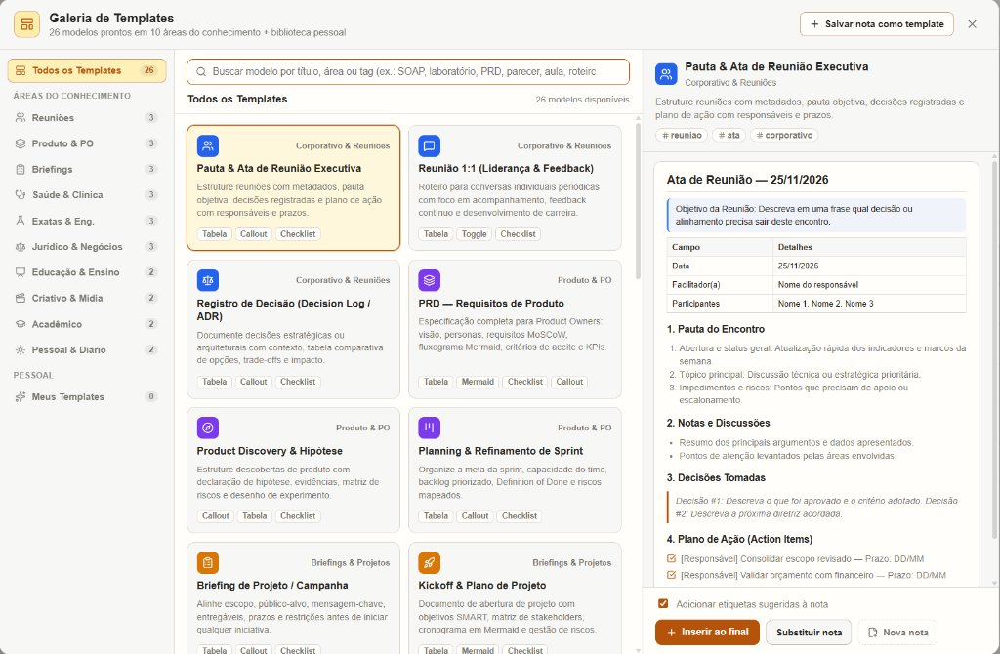
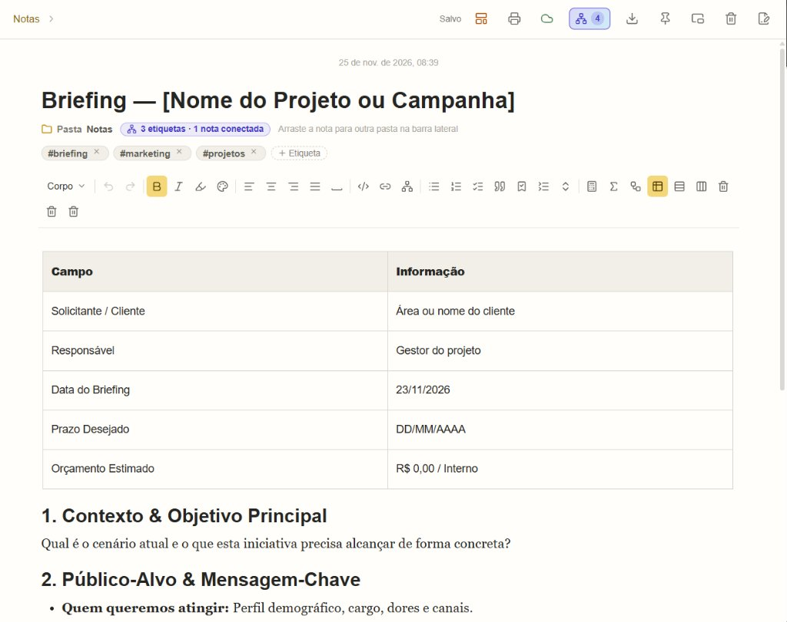
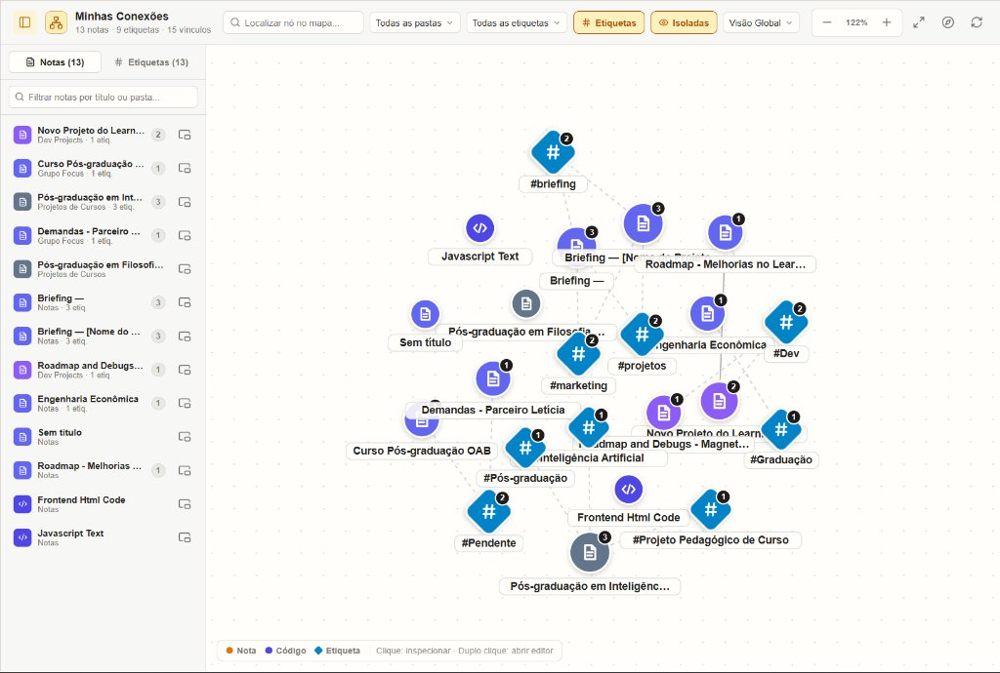

# Magnetares Notes v2.1.0: Galeria de Templates, Minhas Conexões e Salto de Desempenho

No dia a dia — seja conduzindo reuniões, estruturando um novo produto, atendendo pacientes, elaborando um memorial de cálculo ou preparando aulas e pesquisas — dois desafios sempre voltam à mesa: **não perder tempo começando documentos complexos de uma página em branco** e **enxergar como diferentes anotações conversam entre si** à medida que o caderno cresce.

A **versão 2.1.0** do Magnetares Notes nasce exatamente para resolver essas duas frentes, acompanhada de um ciclo profundo de otimização de desempenho e segurança.

---

## Galeria de Templates: 26 Modelos em 10 Áreas + Biblioteca Pessoal

Para todas as notas de texto rico, adicionei a nova **Galeria de Templates** — acessível tanto pelo ícone de grade no cabeçalho da nota quanto pela barra rápida que aparece ao abrir uma nota vazia.

Em um modal amplo de três colunas, você navega por **10 áreas do conhecimento** com **26 modelos prontos**, todos construídos usando os blocos ricos nativos do editor (tabelas estruturadas, callouts semânticos, checklists, fórmulas KaTeX, toggles e diagramas Mermaid):

- **Corporativo, Produto & Briefings:** atas executivas, reuniões 1:1, registros de decisão (ADR), PRDs completos, Product Discovery, Sprint Planning, briefings de campanha, planos de kickoff e post-mortems.
- **Saúde, Engenharia & Jurídico:** evolução clínica SOAP, estudo de caso clínico, memorial de cálculo, relatório de laboratório, RFC técnica, parecer jurídico, matriz SWOT e proposta comercial.
- **Educação, Mídia, Acadêmico & Pessoal:** planos de aula, método Cornell com Active Recall, roteiro audiovisual em duas colunas, estrutura de artigo ABNT e diário pessoal.

Além dos modelos nativos, qualquer nota estruturada que você criar pode ser salva em um clique na sua biblioteca **Meus Templates** direto no SQLite local. E, ao aplicar um template em uma nota que já tenha texto, você escolhe com tranquilidade entre **inserir ao final**, **substituir** ou **gerar uma nova nota**.

---

## Minhas Conexões: Vínculos `[[Nota]]` e Grafo Interativo

Suas notas agora formam uma verdadeira rede conectada. Enquanto escreve, basta digitar **`[[`** para buscar outra nota e inserir uma pílula clicável de referência, ou abrir o **Painel Lateral de Vínculos & Etiquetas** no topo do editor para consultar links de saída, *backlinks* automáticos (quais notas citam o documento atual) e notas relacionadas pelas mesmas tags.

Para explorar o todo, incluí na barra lateral o módulo **CONEXÕES → Minhas Conexões**:

No mapa orientado a forças, cada tipo de item tem ícone e geometria próprios (**Notas**, **Código `< />`** e **Etiquetas `#`**), acompanhados de um selo numérico com o grau de conexão de cada nó. Você pode filtrar por pasta ou etiqueta, ajustar a profundidade de vizinhança (1 a 3 saltos), localizar itens pelo catálogo lateral retrátil e dar **duplo clique** em qualquer nó para abrir o **Editor Completo em Modal** sem sair do grafo.

---

## Mais Leve, Mais Rápido e Ainda Mais Seguro

Também dediquei um ciclo inteiro à engenharia interna da aplicação:

- **Carregamento inicial 93% mais enxuto:** modais pesados, Monaco Editor, Mermaid.js e motores de exportação PDF/ABNT agora são carregados sob demanda, reduzindo o pacote principal de interface para abertura praticamente instantânea.
- **SQLite afinado em todo o pool:** configuração de `WAL`, `busy_timeout`, `foreign_keys` e cache em memória aplicada diretamente em todas as conexões locais, somada a novos índices para tarefas, etiquetas e notas.
- **Fluidez ao digitar em notas longas:** eliminação de serializações redundantes no editor estruturado e auditoria de conformidade executada de forma assíncrona em segundo plano.
- **Reforço de segurança:** isolamento estrito em pré-visualizações HTML, sanitização reforçada em diagramas e exportações, e validação rigorosa de identificadores entre janelas.

---

A versão **2.1.0** já está pronta para acompanhar seus projetos corporativos, estudos e pesquisas mantendo tudo 100% local, privado e sob o seu controle.

Até a próxima!

---

*Acompanhe o desenvolvimento e baixe a nova versão em [magnetaresnotes.com.br](https://magnetaresnotes.com.br).*
